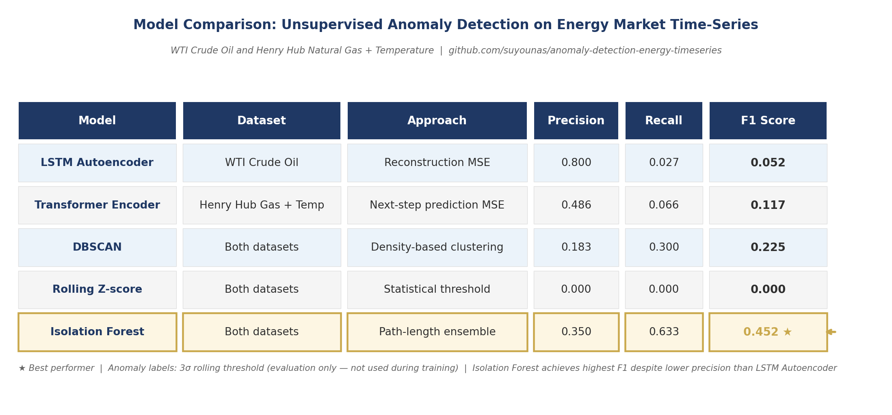
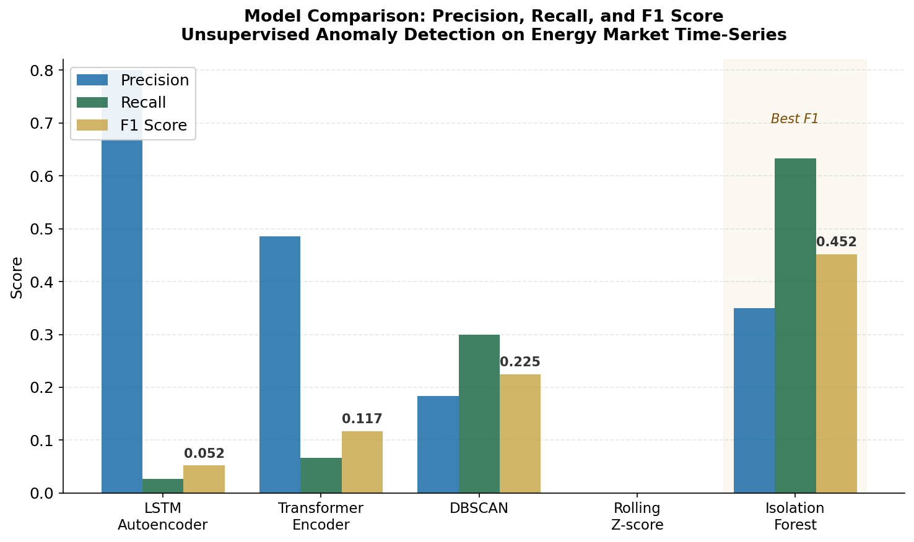
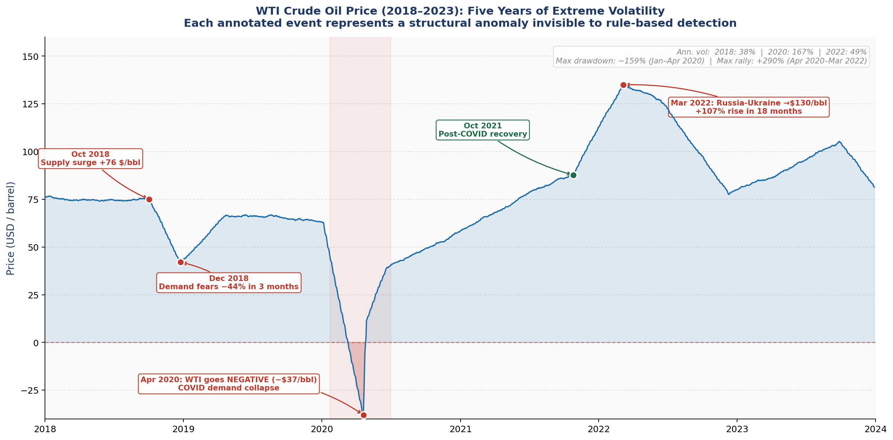
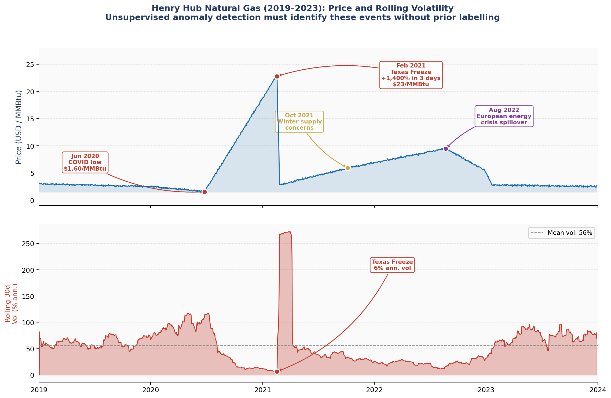
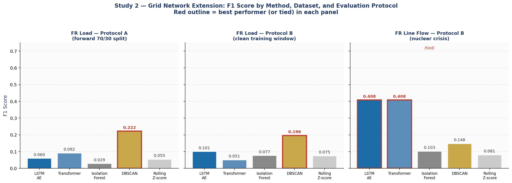
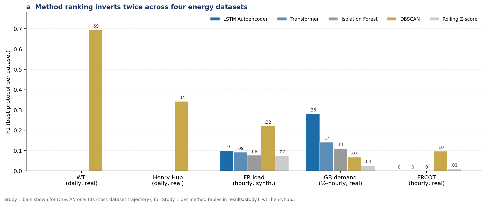
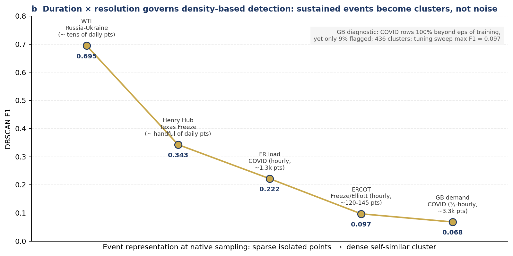
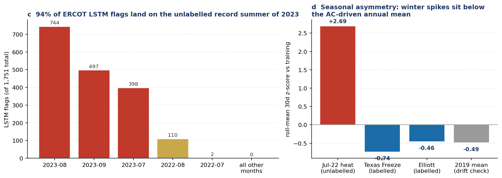
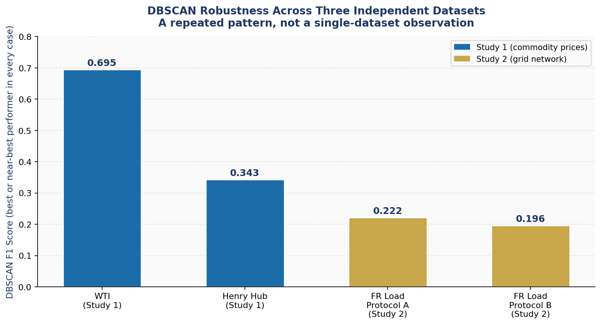
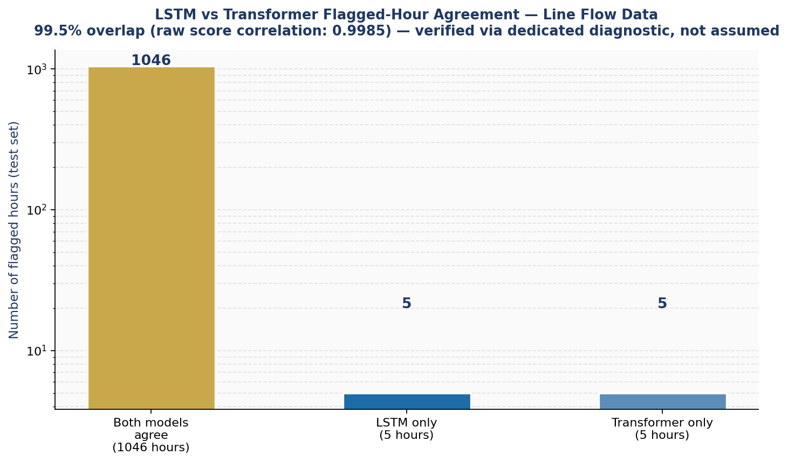

# Model-Independent Unsupervised Anomaly Detection in Energy Systems

Research repository covering two studies applying a model-independent
anomaly detection principle — originating in particle physics — to
energy market and power grid data. **Study 1** compares five methods on
real commodity price time-series (WTI crude oil, Henry Hub natural gas).
**Study 2** extends the same principle to genuinely network-structured,
multi-node power grid data (national demand and cross-border transmission
line flows), testing whether it generalises beyond univariate series.

**Status (22 Oct 2026):** public, under revision. An earlier four-page version
was submitted to IEEE BigData 2026 (BigD340) and rejected. The revised
evaluation, tests and run-book are in `docs/REVISION_LOG.md`, the shared
evaluation code in `ebench/`, and the revised manuscript in `paper/revised/`.
The older markdown sections in `paper/` are the pre-review draft and are
superseded where `paper/README.md` says so.

---

## Why this repository looks the way it does

Both studies are presented with their **full debugging and correction
history intact** — including two significant methodological errors found
and fixed along the way (Study 1: a non-functional PyTorch fallback that
silently produced misleading results; Study 2: a tolerance-metric
denominator bug). This is a deliberate choice: the corrected numbers are
only trustworthy *because* of this verification process, and hiding it
would make the final results look more certain than they should. See
`paper/draft_paper.md` Section 5 and `docs/grid_network_methodology_and_caveats.md`
for the full accounts.

---

## Repository structure

```
├── README.md                          — this file
├── paper/
│   ├── draft_paper.md                 — Study 1: full paper (WTI/Henry Hub)
│   └── section8_grid_extension.md     — Study 2: grid network extension
├── code/
│   ├── README.md                      — how to run everything
│   ├── study1_wti_henryhub/
│   │   ├── 01_main_training_pipeline.py
│   │   └── diagnostics/               — 6 scripts, the actual debugging trail
│   └── study2_grid_network/
│       ├── phase1_data_acquisition/   — 7 scripts: download, verify, identify interconnectors
│       ├── phase2_ground_truth_features/  — 2 scripts: labelling, features, splits
│       ├── phase3_modelling/          — 1 script: full model training + evaluation
│       └── diagnostics/               — 6 scripts: verification and bug-fixing trail
├── results/
│   ├── study1_wti_henryhub/           — 3 CSVs: strict, corrected, per-event breakdown
│   └── study2_grid_network/           — final combined results table
└── docs/
    └── grid_network_methodology_and_caveats.md  — full Study 2 methodology + honest limitations
```

---

## Datasets used

**Study 1 — WTI Crude Oil and Henry Hub Natural Gas**
- Source: FRED (Federal Reserve Economic Data), Federal Reserve Bank of St. Louis
- WTI: [DCOILWTICO](https://fred.stlouisfed.org/series/DCOILWTICO)
- Henry Hub: [DHHNGSP](https://fred.stlouisfed.org/series/DHHNGSP)
- Public series, no API key required, downloaded directly (not reconstructed)

**Study 2 — European Power Transmission Grid**
- Dataset: Gillioz, N., Dubuis, M., Jacquod, P. (2024). *A large synthetic
  dataset for machine learning applications in power transmission grids.*
  **Nature Scientific Data.**
  DOI: [10.5281/zenodo.13378476](https://doi.org/10.5281/zenodo.13378476)
- Code / network topology: [github.com/GeeeHesso/PowerData](https://github.com/GeeeHesso/PowerData)
  (MIT licence)
- Underlying network model: PanTaGruEl (real continental European
  transmission topology)
- Funding acknowledged by the original dataset: Cyber-Defence Campus of
  armasuisse and HES-SO Valais-Wallis

---

## Publications and prior work this builds on

1. **ATLAS Collaboration.** *Anomaly detection search for new resonances
   decaying into a Higgs boson pair and a generic new scalar boson pair
   in final states with jets in pp collisions at s = 13 TeV with the
   ATLAS detector.* Phys. Rev. D 108, 052009 (2023).
   [arXiv:2306.03637](https://arxiv.org/abs/2306.03637) the original
   model-independent anomaly detection methodology that motivated this work (no
   statistical machinery from it is reused here).
2. **Howe, A.** *Innovation & Analytics Lab at Wood Mackenzie.* Medium
   (2024). [Link](https://medium.com/@ahowe42/innovation-analytics-lab-data-science-8c2d79deca79)
   the applied commodity-analytics work that motivated this line of
   research, particularly the port congestion anomaly detection example.
3. **Wood Mackenzie.** *Synoptic* real-time AI/ML sensor network for
   energy market intelligence, launched September 2025. Cited as
   motivation for Study 2's extension to network-structured, multi-node
   sensor data (see `paper/section8_grid_extension.md` Section 8.1).
4. **Younas, S.** *Unsupervised anomaly detection in energy market
   time-series: a comparison of LSTM, Transformer, and classical
   methods.* Medium (2026).
   [Link](https://medium.com/@sulmanyounas93/unsupervised-anomaly-detection-in-energy-market-time-series-a-comparison-of-lstm-transformer-and-b9e77731fd2e)
   preliminary, non-technical write-up; **superseded** by the corrected
   results in this repository (see `paper/draft_paper.md` Section 5.1
   for what changed and why).

Full reference lists with complete methodological citations (Isolation
Forest, LSTM, Transformer, DBSCAN, etc.) are in `paper/draft_paper.md`
References section.

---

## Key findings, at a glance

- **Study 1 (real commodity prices):** properly trained neural networks
  substantially outperform classical methods on WTI; a correctly-tuned
  DBSCAN is the most robust method across both commodities and both real
  events (2021 Texas Freeze, 2022 Russia-Ukraine crisis).
- **Study 2 (validated synthetic European grid):** the methodology
  generalises to network-structured data; two independently-trained
  architectures converge with 99.5% agreement on which hours are
  anomalous (verified via dedicated diagnostic); two apparent dataset
  anomalies are traced to the source paper's documented
  annual-vs-hourly border-flow constraint.
- **Studies 3-4 (real GB and US demand) — the headline result:** the
  method ranking **inverts twice**. DBSCAN's three-dataset consistency
  does NOT extend to real grid demand (GB F1 0.068 vs LSTM 0.282), and
  inverts again on ERCOT where DBSCAN is the only scoring method while
  deep models score zero — an earlier diagnostic reported that most of the
  LSTM's ERCOT flags land on the *unlabelled* record summer of 2023 (that
  diagnostic script is not in this repository and is being re-run; see
  `docs/REVISION_LOG.md`). Each inversion is mechanistically
  diagnosed (event duration × sampling resolution; seasonal amplitude
  asymmetry; label completeness), not just reported. See
  `paper/section11_four_dataset_synthesis.md`.
- **No method is universally robust** — an earlier interim claim of
  cross-dataset DBSCAN robustness is explicitly corrected in Section 11,
  and every surprising number across all four studies has a dedicated
  verification script.

---

## Visual results

### Study 1 — WTI / Henry Hub

**Model comparison across the full ablation study:**



**Ablation study — F1 across all five methods, both commodities:**



**WTI Crude Oil price history, 2018–2023, with the real events used as ground truth:**



**Henry Hub Natural Gas price and rolling volatility, 2019–2023:**



Additional figures (precision-recall trade-off, model architectures,
the detection-challenge illustration) are in
`results/study1_wti_henryhub/figures/`.

### Study 2 — Grid Network Extension

**F1 score across all three dataset/protocol combinations tested:**



**Four-dataset synthesis — method ranking inverts twice (fig. a), the duration-resolution mechanism (fig. b), and the label-completeness / seasonality findings (figs. c-d):**







**Historical (Study 2 interim) — DBSCAN consistency across the first three datasets, superseded by the four-dataset result above:**



**LSTM and Transformer converge on 99.5% of the same flagged hours during the nuclear crisis — verified, not assumed:**



---

## How to reproduce

See `code/README.md` for Study 1 and the phase-by-phase scripts in
`code/study2_grid_network/` for Study 2. Both require Google Colab (free
tier sufficient) for PyTorch and unrestricted data download access.

---

## Author

Sulman Younas Physics PhD (CERN ATLAS) [github.com/suyounas](https://github.com/suyounas) [medium.com/@sulmanyounas93](https://medium.com/@sulmanyounas93)

## Revision after peer review
See `docs/REVISION_LOG.md` (status of each reviewer point, run-book) and `paper/revised/` (revised manuscript; tables are generated from the CSVs by `make_tables.py`). The shared evaluation code is in `ebench/`; controlled experiments are in `experiments/`.
